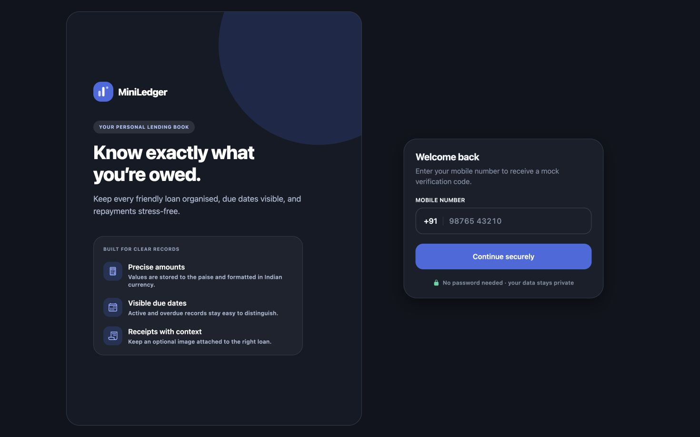
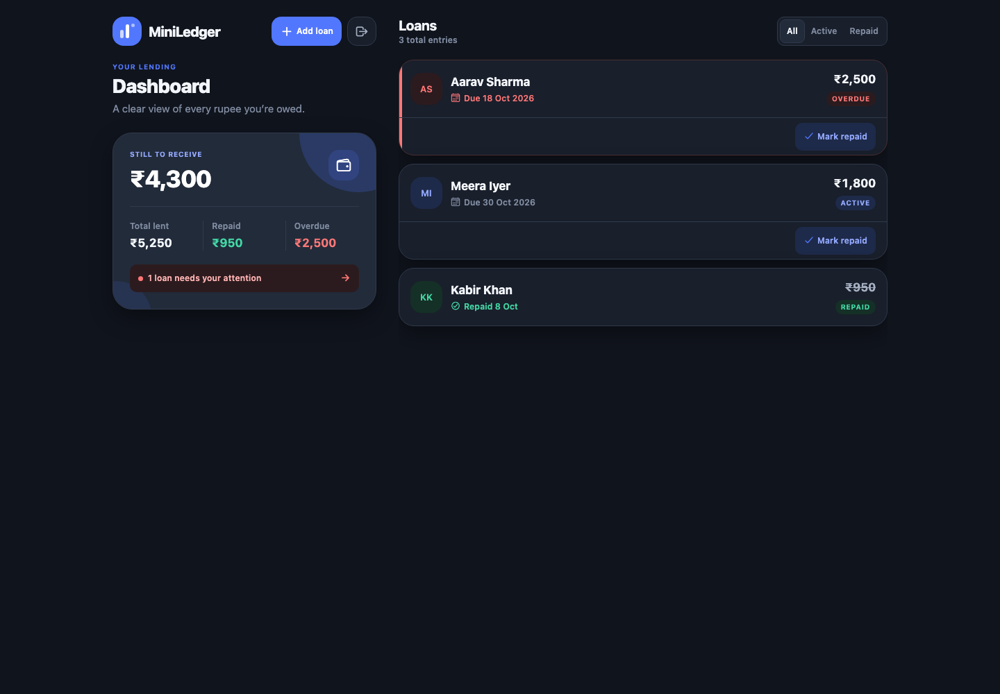
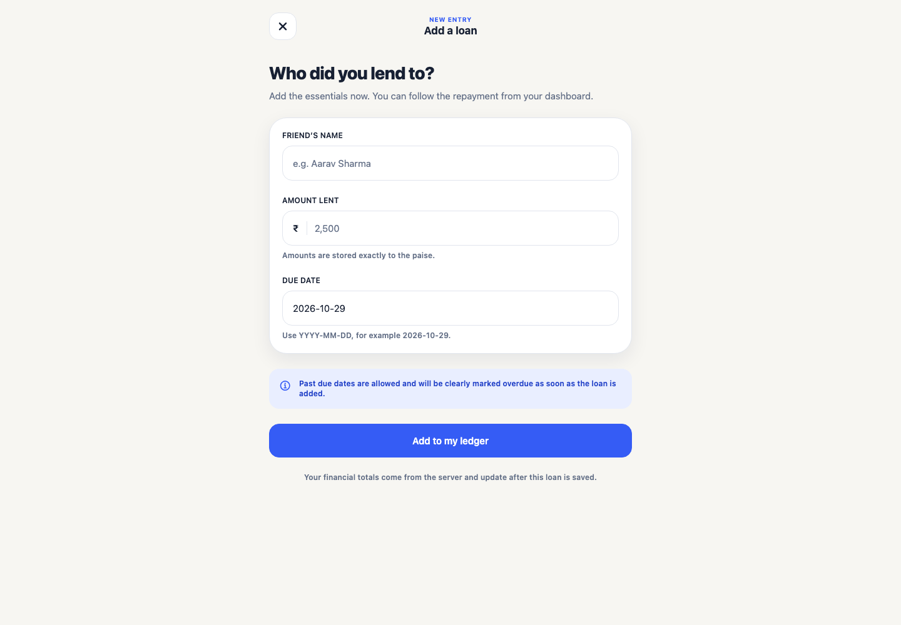
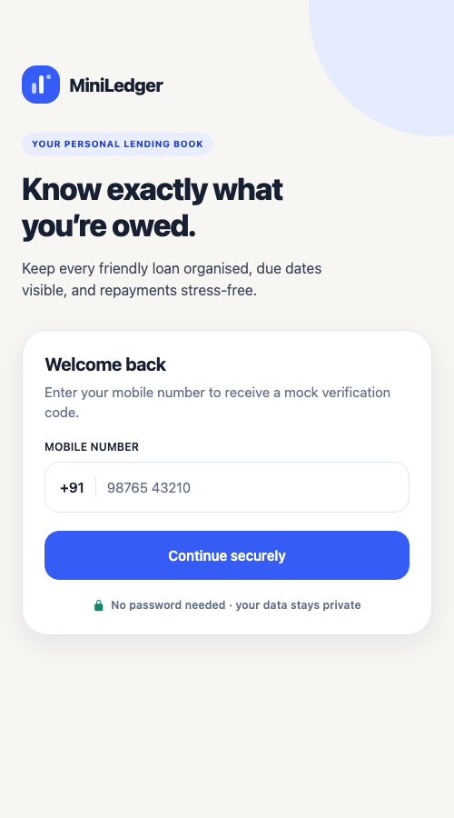
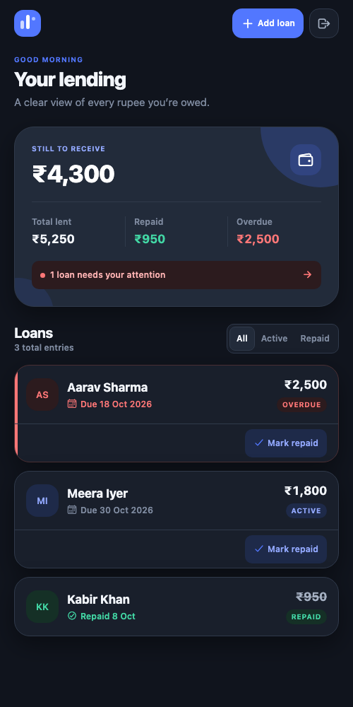

# MiniLedger

MiniLedger is a focused mobile lending tracker for money lent to friends. It combines a polished Expo application with a typed Express API and PostgreSQL persistence, so login, loan creation, overdue status, repayment, and every dashboard total come from real server data.

## What it does

- Passwordless Indian mobile login with a six-digit development OTP printed by the API
- Secure session persistence using Expo SecureStore on native devices
- Server-calculated total lent, repaid, outstanding, and overdue amounts
- Loan creation with client and server validation
- Strong visual treatment for overdue loans without relying on colour alone
- Confirmation before repayment and immediate query refresh afterward
- Loan list filters, pull-to-refresh, detail pages, and logout
- Purposeful loading, empty, validation, error, and success states
- User ownership checks on every protected loan operation
- Exact money storage in integer paise
- Optional receipt photo per loan, with secure upload, private storage, and authenticated preview
- 97 automated tests: 27 mobile component/integration tests plus 70 backend tests covering authentication, production configuration, OTP boundaries, JWT algorithm pinning, loans, ownership, dates, summaries, receipt validation and cleanup consistency, deterministic receipt concurrency, filesystem permissions, request failure classification, and a real-PostgreSQL concurrent-repayment integration test

The required login, lending, repayment, and summary journey is complete and tested, and the optional receipt-photo bonus is implemented end to end (see [Receipts](#receipts)).

## Architecture

```text
Expo mobile app
  ├── Expo Router screens
  ├── React Hook Form + Zod
  ├── TanStack Query
  └── typed API client + SecureStore
              │ JSON / JWT
              ▼
Express API
  ├── OTP + JWT authentication
  ├── validation and error boundary
  ├── loan and summary services
  └── Prisma data store
              │
              ▼
PostgreSQL (integer paise, DATE due dates)
```

The API is authoritative for status and financial totals. The client never recomputes a summary or simulates a successful mutation. See [architecture notes](docs/architecture.md) for the full lifecycle and trade-offs.

## Responsive design

The app is built mobile-first with React Native Web, and composition — not just font size — changes by viewport (`apps/mobile/hooks/use-responsive.ts`):

- **Mobile:** a single natural column with a full-width summary card and a scannable loan list.
- **Desktop (≥1024px):** a deliberate two-column shell — a summary/overview sidebar beside a dedicated loan-list column — instead of a narrow centred strip. Login uses a two-column split: a brand/product panel (with an illustrative, clearly-labelled sample ledger) beside a focused authentication panel.

### Design system & motion

Tokens live in `apps/mobile/constants/theme.ts` and are applied across every screen. The "Midnight Ledger" identity uses layered dark surfaces (graphite canvas → slate cards → elevated panels), restrained electric-blue for primary actions and active states, and semantic mint/coral/amber reserved for repaid, overdue, and warning states (never colour alone — status also carries a label and icon). The outstanding balance sits on the brightest elevated panel as the primary anchor, and financial amounts use exact INR formatting with tabular numerals.

Motion is restrained and purposeful (`components/fade-in-view.tsx`): a short fade-and-rise entrance on native (iOS/Android) that honours the OS *reduce motion* setting, plus button press feedback, stable loading skeletons, and a success banner shown only after the server confirms repayment. On React Native Web the entrance renders statically so motion can never conceal content.

## Screenshots

Captured from the running web build against the seeded PostgreSQL database, with real session data.

**Desktop — 1440px**

| Login | Dashboard | Add loan |
| --- | --- | --- |
|  |  |  |

**Mobile — narrow single column**

| Login | Dashboard |
| --- | --- |
|  |  |

**Receipt lifecycle**

The add-loan screenshot above includes the optional receipt selector. The detail view below shows an attached receipt with view, replace, and remove controls.


The committed narrow captures were taken at a 500px viewport. The running web app was additionally inspected at 360px, 375px, 390px, and 430px on 23 October 2026 without horizontal overflow; native rendering at those widths still requires the device smoke test before submission.

## Technology

- Mobile: React Native 0.81, Expo SDK 54, Expo Router 6, TypeScript
- Forms/state: React Hook Form, Zod, TanStack Query
- Backend: Node.js, Express 5, TypeScript, JWT, Zod
- Data: PostgreSQL 16, Prisma 6 migrations
- Tests: Jest + React Native Testing Library for mobile; Vitest + Supertest for the API, with an isolated in-memory data-store adapter and gated PostgreSQL integration

## Repository layout

```text
apps/mobile/       Expo application, screens, components, theme, API client
backend/           Express API, Prisma schema/migration, services, tests
packages/shared/   Shared API response types
docs/              API, architecture, interview, smoke-test, and demo notes
```

## Prerequisites

- Node.js 20 or newer (verified with Node 24.18.0)
- npm 11 or newer
- PostgreSQL 16, either local or through Docker
- Expo Go, an emulator, or an iOS/Android development environment for device testing

## Setup

```bash
git clone https://github.com/rajatnagda45/MINILEDGER.git
cd MINILEDGER
npm install
cp .env.example .env
cp apps/mobile/.env.example apps/mobile/.env.local
npm run db:generate
```

Replace `JWT_SECRET` and `OTP_PEPPER` in `.env` with different long random values. The committed example contains placeholders only.

There is a single environment file at the repository root. The API loads it at runtime, and the Prisma CLI loads it through `backend/prisma.config.ts`, so `db:generate`, `db:migrate`, `db:deploy`, and `db:seed` all resolve `DATABASE_URL` from the same place — no separate `backend/.env` is needed.

### Start PostgreSQL with Docker

```bash
docker compose up -d postgres
npm run db:migrate
npm run db:seed
```

If PostgreSQL already occupies port 5432, either use that server and update `DATABASE_URL`, or stop it before starting the Compose service. Never run the migrations against an unspecified database.

### Start the API

```bash
npm run dev:backend
```

The health endpoint is `http://localhost:4000/api/health`.

### Start the mobile app

Open a second terminal:

```bash
npm run dev:mobile
```

Then press `i` for iOS, `a` for Android, or scan the Expo QR code with a device.

## Mobile network configuration

Set `EXPO_PUBLIC_API_URL` in `apps/mobile/.env.local` before starting Expo. Restart Metro after changing it.

| Run target | Typical value |
|---|---|
| iOS simulator | `http://127.0.0.1:4000/api` |
| Android emulator | `http://10.0.2.2:4000/api` |
| Physical phone | `http://YOUR_MAC_LAN_IP:4000/api` |

The phone and development Mac must be on the same network. Ensure the API listens on a reachable interface and the local firewall allows port 4000 when using a physical device. Do not put secrets in any `EXPO_PUBLIC_` variable.

## Mock OTP login

1. Enter a valid Indian mobile number, such as `9876543210`.
2. Tap **Continue securely**.
3. Read the API terminal line: `[DEV OTP] +919876543210: 123456`.
4. Enter that code in the app.

The code expires after five minutes, has a 30-second resend cooldown, permits five verification attempts, and is removed after successful use. Only a hash is kept in memory. Restarting the API clears outstanding challenges. Terminal OTP logging is assignment-specific and must be replaced by an SMS provider in production.

## Commands

```bash
npm run typecheck       # all workspaces
npm test                # mobile and backend automated tests
npm run test:mobile     # mobile component/integration tests only
npm run lint            # Expo ESLint rules
npm run db:generate     # generate Prisma client
npm run db:migrate      # create/apply a development migration
npm run db:seed         # add demonstration records
npm run dev:backend     # Express API with watch mode
npm run dev:mobile      # Expo development server
```

To verify release bundling:

```bash
cd apps/mobile
npx expo export --platform ios
npx expo export --platform android
npx expo export --platform web
```

### What each command needs

| Command | Requires | CI-safe |
|---|---|---|
| `npm run typecheck`, `npm run lint` | nothing | yes |
| `npm test` | nothing for mobile tests and most API tests. The real-PostgreSQL integration test runs only when `pg_isready` succeeds and is otherwise skipped (reported, not failed) | yes |
| `npm run db:generate` | the root `.env` (no database connection) | yes |
| `npm run db:migrate`, `db:deploy`, `db:seed`, `dev:backend` | a running PostgreSQL reachable at `DATABASE_URL` | no |
| `npx expo export --platform …` | nothing (produces JS bundles) | yes |

All database commands resolve `DATABASE_URL` from the root `.env` via `backend/prisma.config.ts`; there is no separate `backend/.env`.

## API overview

All protected endpoints require `Authorization: Bearer <token>`.

| Method | Endpoint | Purpose |
|---|---|---|
| GET | `/api/health` | Health check |
| POST | `/api/auth/send-otp` | Create a mock OTP challenge |
| POST | `/api/auth/verify-otp` | Verify OTP and return JWT |
| GET | `/api/loans` | List the signed-in user's loans |
| GET | `/api/loans/:id` | Read one owned loan |
| POST | `/api/loans` | Create a loan |
| PATCH | `/api/loans/:id/repay` | Mark an owned loan repaid |
| GET | `/api/summary` | Return server-calculated totals |
| POST | `/api/loans/:id/receipt` | Attach or replace an owned loan's receipt (multipart `receipt`) |
| GET | `/api/loans/:id/receipt` | Stream the owned receipt image (authenticated) |
| DELETE | `/api/loans/:id/receipt` | Remove the owned loan's receipt |

Example loan request:

```json
{
  "friendName": "Aarav Sharma",
  "amount": 2500,
  "dueDate": "2026-10-30"
}
```

Amounts are rupee numbers in JSON and integer paise in PostgreSQL. See the complete [API reference](docs/api.md).

## Receipts

Each loan can optionally carry one receipt photo.

- **Formats and size:** JPEG or PNG only, up to 5 MB (`RECEIPT_MAX_BYTES`). The declared MIME type and filename are never trusted — the server performs a bounded structural inspection (PNG `IHDR`/`IEND`, JPEG `SOI`/`SOF`/`EOI`), rejects truncated or malformed files, and bounds the real pixel dimensions (≤12000 per side, ≤40 MP) to block absurd/decompression-bomb images. It does not re-encode the image.
- **Where files live:** binaries are written to a private directory (`RECEIPT_STORAGE_DIR`, default `backend/.receipts`) created `0700` with files `0600` (on POSIX), **never statically served**, and gitignored. Filenames are random server-generated keys (never the uploaded name), written with exclusive-create (no overwrite, no symlink following). PostgreSQL stores only metadata (storage key, verified media type, byte size, timestamp) in a `receipts` table related one-to-one to the loan. The deployment account and volume must keep this directory private.
- **Privacy and ownership:** every upload, download, and delete requires a valid JWT and verifies the loan belongs to the caller, so one user can never read or change another user's receipt (cross-user requests return `404`). The image is served from an authenticated endpoint with `X-Content-Type-Options: nosniff` and `Cache-Control: private, no-store`, and is never returned as base64 inside JSON.
- **Consistency:** storage and the database are not one transaction, so operations are ordered to stay safe. A replacement writes the new object, persists metadata, then removes the old object; a **deletion removes the file before its metadata**, so a failed file delete leaves the receipt intact and the request can be retried — the API never reports success while a private file remains on disk. Genuine cleanup failures are recorded in an `orphaned_objects` tombstone and retried by `reconcileOrphans()` (run best-effort at startup), so an orphan is never silently lost. Receipts never affect financial totals.
- **Client:** the add-loan form has an optional Receipt section (choose from library, or camera on native); the loan detail screen shows a thumbnail with view/replace/remove. On web the image is fetched with the token and shown via an object URL; on native `Image` sends the auth header directly.

### Environment

| Variable | Default | Purpose |
|---|---|---|
| `RECEIPT_STORAGE_DIR` | `.receipts` | Private directory for receipt binaries (relative to the backend process) |
| `RECEIPT_MAX_BYTES` | `5242880` | Maximum accepted upload size in bytes |

Run `npm run db:migrate` to apply all committed migrations before using the feature.

### Manual test

1. Sign in and open or create a loan.
2. On the add-loan form, tap **Choose photo** and pick a JPEG or PNG; submit.
3. Open the loan — the receipt thumbnail appears. Tap **View** to open it, **Replace** to swap it, or **Remove** to delete it.
4. Confirm the summary totals are unchanged by attaching or removing a receipt.

### S3 (future deployment, not implemented)

`ReceiptStorage` is a small interface (`save`/`read`/`delete`). The local filesystem implementation is used today; a private-bucket Amazon S3 implementation can be dropped in without changing callers. It would use private object ACLs and short-lived signed URLs (or keep streaming through the authenticated endpoint) and must never expose permanent public URLs. This is an extension point only — S3 support is not currently built.

## Verification status

The latest automatic, native-runtime, and developer-action gates are separated in [docs/release-candidate-checklist.md](docs/release-candidate-checklist.md).

Verified on 23 October 2026:

- TypeScript passed across mobile, backend, and shared packages.
- 97 automated tests passed across 18 test files: 27 mobile tests covering auth, web/native token storage, state rendering, forms, duplicate submission, query refresh, receipts, cancellation/network/timeout handling and accessibility cues; plus 70 backend tests including hardened production configuration and a real-PostgreSQL concurrency integration test.
- Expo ESLint completed without warnings or errors.
- Prisma generation and schema validation passed, and all three migrations are applied to PostgreSQL 16.
- OTP issue/verification (`[DEV OTP]` log), authenticated loan listing, server-calculated summary, and the full receipt lifecycle (upload, authenticated retrieval with byte-exact download, cross-user denial, deletion, and unchanged summary) were exercised against the real PostgreSQL database and local file storage.
- Expo produced a successful web release bundle (`expo export --platform web`).
- The web build was served and loaded in headless Chrome with a real session token; genuine screenshots of login, dashboard, and add-loan were captured at desktop (1440px) and narrow (500px) viewports — see [Screenshots](#screenshots).

No iOS simulator or connected physical device was available in the build environment, so native touch interaction and iOS/Android visual QA still need the short manual pass in [docs/manual-smoke-test.md](docs/manual-smoke-test.md). The web app was visually inspected at 360px, 375px, 390px, and 430px on 23 October 2026; the committed narrow gallery remains at 500px. The desktop/mobile web visuals are evidenced by the captured screenshots and runtime inspection; native-only rendering is not claimed from them. No screenshots or device-test claims are fabricated.

## Security and limits

- Loan access always includes the authenticated `userId` in the data query.
- OTPs are cryptographically generated, hashed with a pepper, time-limited, attempt-limited, cooldown-protected, and one-time use.
- OTP values are printed only outside production mode; production configuration never uses the development logger.
- Production startup rejects the committed example secrets and wildcard `MOBILE_ORIGIN`; deployment must provide distinct secrets and an explicit trusted web origin.
- JWTs are issuer/audience checked; secrets are environment-only.
- Request bodies are size-limited, security headers are enabled, and errors use a stable non-sensitive shape.
- Full repayment is the only repayment model; partial repayment is intentionally out of scope.
- OTP challenges are held in process memory, so they are not shared across multiple API instances.
- Receipt storage uses the local filesystem; a private-bucket S3 backend is an interface extension, not built yet. Only JPEG/PNG are accepted (e.g. iOS HEIC captures are rejected). Loan deletion is not implemented.
- The current npm advisory report contains 52 affected package nodes (49 high, 3 moderate, 0 critical), primarily in Expo/Metro/Jest/Prisma toolchains; the Router decoding chain is the material client-runtime path. Supported fixes require coordinated major upgrades, so do not apply `npm audit fix --force` without a planned Expo/React Native, Router, Prisma, and Jest migration plus full native regression testing.

## Demo recording

The concise recording plan is in [docs/demo-script.md](docs/demo-script.md). Add the real Loom or Drive URL here only after recording and checking access permissions.

