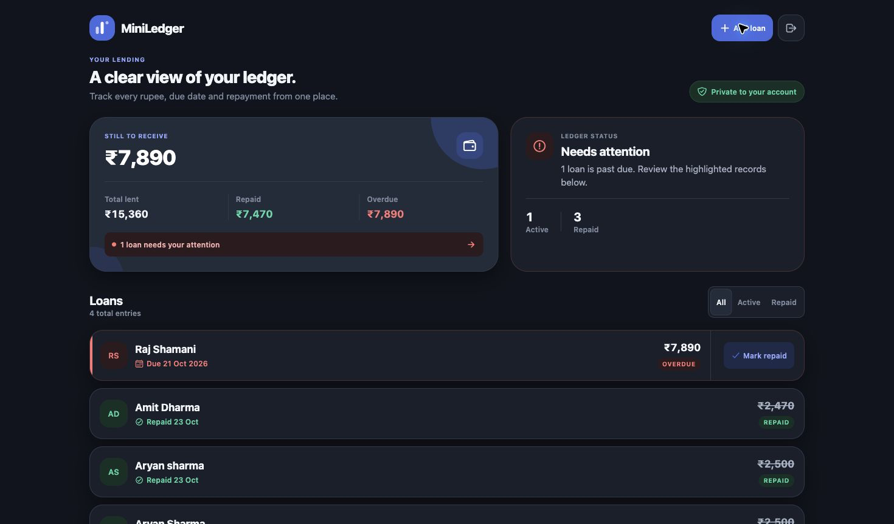
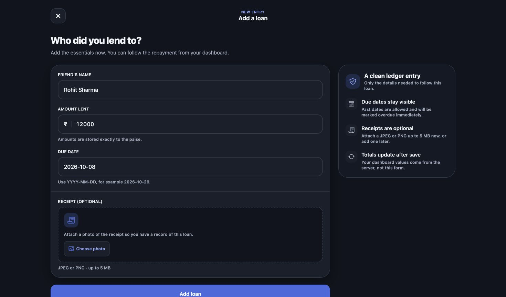
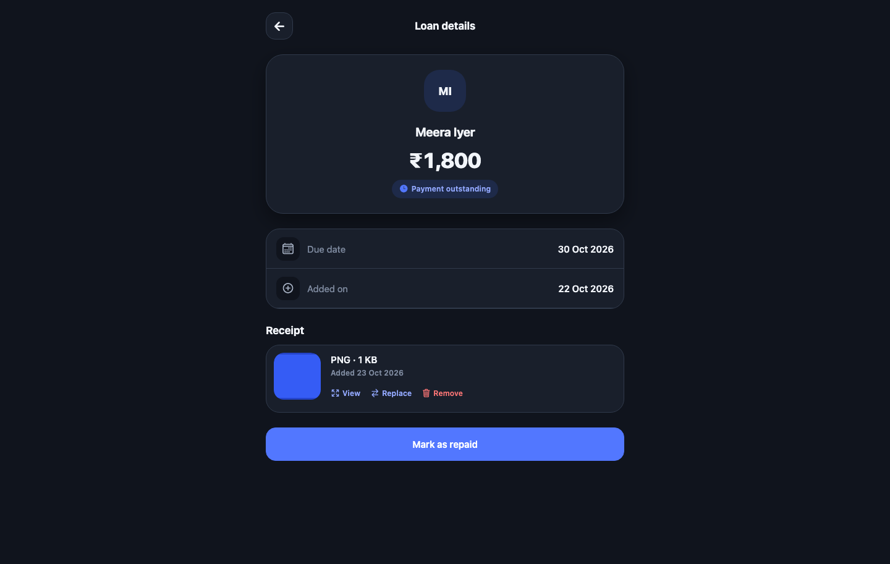

# MiniLedger

MiniLedger is a React Native lending tracker for money lent to friends. It records due dates and repayments, highlights overdue loans, and presents server-calculated outstanding balances through an Expo app backed by Express, Prisma, and PostgreSQL.

## Demo recording

> **TODO: Add public 2–3 minute demo recording URL**

A genuine public recording has not been added yet. Before submission, record the real app, enable reviewer access, and verify the link in a private browser window. A concise walkthrough is available in the [demo script](docs/demo-script.md).

## Screenshots

These captures come from the running web build using seeded local demonstration records. They show assignment functionality and do not represent a production account or real financial activity.

| Login | Dashboard | Add loan |
| --- | --- | --- |
|  |  |  |

The optional receipt workflow is also implemented:



## Features

- Mock OTP authentication using an Indian mobile number and a development code printed by the API
- Authenticated session restoration on web and native, with secure native storage through Expo SecureStore
- Loan creation with friend name, amount, due date, client validation, and server validation
- Loan listing with clear active, repaid, and overdue states
- Confirmed full repayment with refreshed loan and summary data
- Server-calculated total lent, repaid, outstanding, and overdue amounts
- User ownership checks on every protected loan operation
- Exact currency persistence in integer paise and Indian currency formatting
- Optional authenticated receipt-photo upload, preview, replacement, and removal
- Automated mobile and backend tests

## Technology stack

- **App:** React Native 0.81, Expo SDK 54, Expo Router 6, React 19, TypeScript
- **Backend:** Node.js 20+, Express 5, JSON Web Tokens
- **Database:** PostgreSQL 16, Prisma 6
- **Validation and state:** Zod, React Hook Form, TanStack Query
- **Testing:** Jest, React Native Testing Library, Vitest, Supertest

## Architecture

```text
React Native / Expo app
          │  JSON API + JWT
          ▼
     Express API
          │
          ▼
        Prisma
          │
          ▼
     PostgreSQL 16
```

The API is authoritative for authentication, ownership, loan status, and financial totals. The client renders those responses and invalidates the relevant queries after successful mutations. See [docs/architecture.md](docs/architecture.md) for the detailed request, authentication, repayment, and receipt lifecycles.

## Prerequisites

- Node.js 20 or newer
- npm 11 or newer
- PostgreSQL 16, either installed locally or started with Docker
- Expo Go, an iOS/Android simulator, or a web browser for the app

## Quick start

### 1. Clone and install

```bash
git clone https://github.com/rajatnagda45/MINILEDGER.git
cd MINILEDGER
npm install
```

### 2. Create local environment files

```bash
cp .env.example .env
cp apps/mobile/.env.example apps/mobile/.env.local
```

Replace the placeholder `JWT_SECRET` and `OTP_PEPPER` values in `.env` with different random values of at least 32 characters. Keep `EXPO_PUBLIC_API_URL` in `apps/mobile/.env.local` pointed at the API:

| App target | `EXPO_PUBLIC_API_URL` |
| --- | --- |
| Web or iOS simulator | `http://127.0.0.1:4000/api` |
| Android emulator | `http://10.0.2.2:4000/api` |
| Physical device | `http://YOUR_COMPUTER_LAN_IP:4000/api` |

Only public runtime configuration belongs in `EXPO_PUBLIC_` variables; never place secrets there.

### 3. Start PostgreSQL and prepare the database

```bash
docker compose up -d postgres
npm run db:generate
npm run db:migrate
```

The application works with an empty database. To add optional local demonstration records:

```bash
npm run db:seed
```

All Prisma commands read `DATABASE_URL` from the repository-root `.env` through `backend/prisma.config.ts`.

### 4. Start the backend

```bash
npm run dev:backend
```

The API runs at `http://localhost:4000/api`; its health endpoint is `GET /api/health`.

### 5. Start the Expo app

In another terminal:

```bash
npm run dev:mobile
```

Press `w` for the web app, `i` for the iOS simulator, `a` for Android, or scan the QR code with Expo Go. Restart Expo after changing `EXPO_PUBLIC_API_URL`.

## Mock OTP login

1. Enter a valid Indian mobile number.
2. Select **Continue securely**.
3. Read the development OTP from the backend terminal.
4. Enter the six-digit code to authenticate.

Illustrative development log format:

```text
[DEV OTP] +91XXXXXXXXXX: 123456
```

This is a development-only mock flow for the assignment; it does not send an SMS. OTPs expire after five minutes, enforce a resend cooldown and attempt limit, and are removed after successful use.

## Verification

```bash
npm test            # mobile and backend tests
npm run typecheck   # TypeScript across workspaces
npm run lint        # configured workspace lint checks
```

Current verified test result: **124 passed** — 54 mobile tests and 70 backend tests, with no failures or skipped tests reported. Native device interaction is not claimed by this automated result.

## API overview

Protected routes require `Authorization: Bearer <token>`.

| Method | Endpoint | Purpose |
| --- | --- | --- |
| `POST` | `/api/auth/send-otp` | Issue a development OTP challenge |
| `POST` | `/api/auth/verify-otp` | Verify the OTP and return a session token |
| `GET` | `/api/loans` | List the authenticated user's loans |
| `POST` | `/api/loans` | Create a loan |
| `PATCH` | `/api/loans/:id/repay` | Mark an owned loan as repaid |
| `GET` | `/api/summary` | Return server-calculated financial totals |

The optional receipt bonus uses authenticated `POST`, `GET`, and `DELETE` routes at `/api/loans/:id/receipt`. See the [API reference](docs/api.md) for request bodies, responses, validation rules, and error codes.

## Assignment mapping

| Assignment requirement | Implementation |
| --- | --- |
| Phone login with mock OTP | Expo login/verification screens and `/api/auth/*` routes |
| Create a loan | Add Loan form and `POST /api/loans` |
| List loans and highlight overdue entries | Dashboard loan list using API-provided status and `isOverdue` |
| Mark a loan as repaid | Confirmation flow and `PATCH /api/loans/:id/repay` |
| Summary card | `GET /api/summary` and dashboard financial overview |
| PostgreSQL persistence | Prisma models and committed migrations |
| Input validation | React Hook Form/Zod plus backend Zod validation |
| Automated tests | 54 mobile tests and 70 backend tests |
| Receipt-photo bonus | Authenticated upload, viewing, replacement, and removal |

## Project documentation

- [API reference](docs/api.md)
- [Architecture and engineering decisions](docs/architecture.md)
- [Demo recording script](docs/demo-script.md)
- [Manual device smoke test](docs/manual-smoke-test.md)

## Limitations

- Authentication uses a development-only mock OTP stored in process memory; there is no SMS provider.
- The repayment model supports full repayment, not partial payments.
- Receipt files use private local filesystem storage and accept JPEG/PNG; production deployment would need durable private object storage.
- Native iOS/Android runtime testing still requires a simulator or physical-device smoke test.
- The required public 2–3 minute demo recording has not yet been added.
